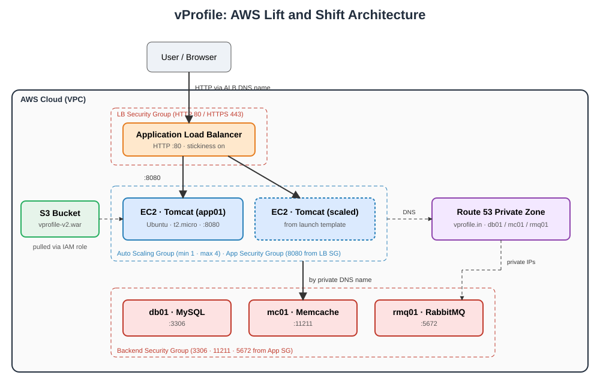
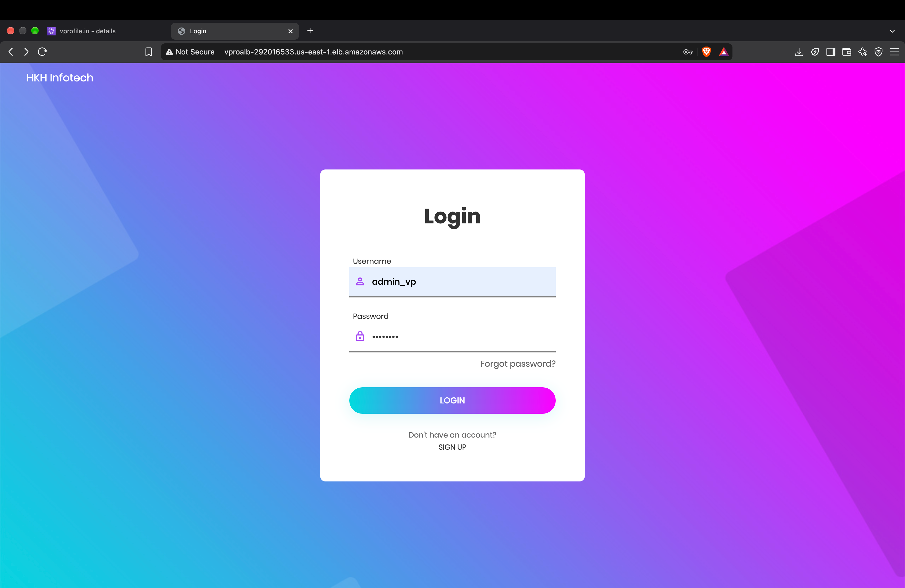
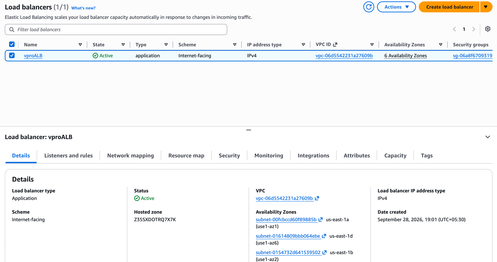
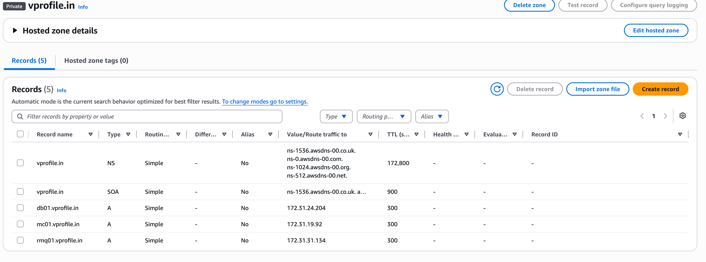
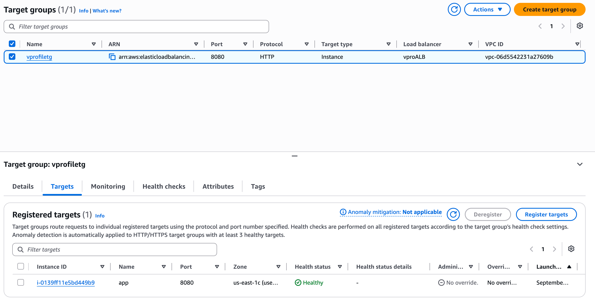

# ☁️ AWS Lift and Shift: Hosting the vProfile Application

Migrating a multi-tier Java web application from a traditional data-centre setup to AWS using the **lift and shift (rehost)** strategy.

## 📌 Overview
The vProfile application (Tomcat, MySQL, Memcache, RabbitMQ) is rehosted on AWS with minimal code changes. Compute runs on EC2, traffic is balanced by an Application Load Balancer, scaling is automated with an Auto Scaling Group, and backend services are discovered through a Route 53 private hosted zone.

## ❗ Problem
- Physical/virtual servers need virtualization, ops, monitoring and sysadmin teams
- Scaling up/down is slow and mostly manual
- High upfront hardware cost plus ongoing maintenance

## ✅ Solution
Move the workload to AWS (IaaS): pay as you go, elastic scaling, easier infrastructure management and room for automation.

## 🎯 Objectives
- Flexible infrastructure
- No upfront cost
- Modernize effectively
- Path toward Infrastructure as Code

## 🏗️ Architecture


**Request flow**
1. User opens the Application Load Balancer's DNS name in the browser (HTTP)
2. ALB forwards requests to Tomcat instances in an Auto Scaling Group (port 8080)
3. Tomcat resolves backend servers by name via the Route 53 private hosted zone
4. Backend EC2 instances run MySQL, Memcache and RabbitMQ

## 🧰 AWS Services Used
| Service | Purpose |
|---|---|
| EC2 | VMs for Tomcat, MySQL, Memcache, RabbitMQ |
| ELB (ALB) | Load balancing (replaces nginx) |
| Auto Scaling | Scale out/in on load |
| S3 | Stores the build artifact (WAR) |
| Route 53 | Private DNS for backend services |
| IAM | User for CLI access, role for EC2 → S3 access |
| EBS | Instance storage |
| Security Groups | Tier-level network isolation |

## 🔐 Security Groups
| SG | Inbound rules |
|---|---|
| **LB SG** | HTTP 80 and HTTPS 443 from anywhere (IPv4 + IPv6) |
| **App (Tomcat) SG** | TCP 8080 from LB SG; SSH 22 from my IP; 8080 from my IP |
| **Backend SG** | MySQL 3306, Memcache 11211, RabbitMQ 5672 from App SG; SSH 22 from my IP; all traffic from App SG |

## 🔄 Flow of Execution
1. Log in to AWS
2. Create key pair
3. Create security groups
4. Launch instances with user data (bash scripts)
5. Update IP-to-name mapping in Route 53
6. Build the application from source
7. Upload the artifact to S3
8. Download the artifact to the Tomcat EC2 instance
9. Set up the ALB, target group and Auto Scaling
10. Verify using the ALB DNS name

## 🛠️ Implementation

### 1. Security groups and key pair
Create the three SGs above, then a key pair (`.pem`) for SSH.

### 2. Launch EC2 instances
Four instances, each with the matching script pasted into **Advanced details → User data** ([scripts from source repo](https://github.com/hkhcoder/vprofile-project)):

| Instance | Role | OS | SG |
|---|---|---|---|
| db01 | MySQL | Amazon Linux | Backend |
| mc01 | Memcache | Amazon Linux | Backend |
| rmq01 | RabbitMQ | Amazon Linux | Backend |
| app01 | Tomcat | Ubuntu | App |

SSH into each to confirm services are running.

### 3. Route 53 private hosted zone
- Create private hosted zone `vprofile.in` (your region + default VPC)
- Add A records for `db01`, `mc01`, `rmq01` pointing to their **private IPs**
- Verify from app01:
```bash
ping -c 4 db01.vprofile.in
```

### 4. S3 bucket and IAM
- Create a general-purpose S3 bucket
- Create an IAM user (S3 access) and generate an access key for the CLI
- Create an IAM role (use case: EC2, S3 permission) and attach it to app01 via **Actions → Security → Modify IAM role**

> 💡 I used S3 full access for simplicity; for production, scope the policy to the specific bucket (least privilege).

### 5. Build and upload the artifact (local machine)
```bash
mvn -version            # verify JDK + Maven
aws --version           # verify AWS CLI
mvn install
aws configure
aws s3 cp target/vprofile-v2.war s3://<bucket-name>/
```

### 6. Deploy on Tomcat (app01)
```bash
ssh -i <key>.pem ubuntu@<app01-public-ip>
sudo snap install aws-cli --classic
aws s3 cp s3://<bucket-name>/vprofile-v2.war /tmp/
sudo systemctl stop tomcat10
sudo rm -rf /var/lib/tomcat10/webapps/ROOT
sudo cp /tmp/vprofile-v2.war /var/lib/tomcat10/webapps/ROOT.war
sudo systemctl start tomcat10
```

### 7. Application Load Balancer
- Create target group (instances, port 8080; override health-check port to 8080)
- Create an internet-facing ALB across all AZs with the LB SG and an HTTP :80 listener forwarding to the target group
- Access the app using the ALB DNS name

### 8. Auto Scaling
1. Create an **AMI** from app01
2. Create a **launch template** (app AMI, t2.micro, App SG, key pair, IAM role in advanced settings)
3. Create an **Auto Scaling Group**: use the launch template, all AZs, attach to the existing ALB and target group, enable health checks
4. Desired 1, min 1, max 4, with a **target tracking scaling policy**

### 9. Enable stickiness
Target group → Attributes → Edit → **Stickiness ON**.
vProfile keeps login sessions in the instance itself, so without stickiness a user routed to another instance gets logged out.

## ✅ Verification
- Target group shows healthy targets
- App loads at `http://<alb-dns-name>`
- Login works; scaling out keeps sessions (with stickiness)

## 📸 Screenshots





## 🧹 Cleanup
Delete the ASG, ALB, target group, EC2 instances, AMI and snapshots, S3 bucket, hosted zone and unused IAM users to avoid charges.

## 📚 Key Learnings
- Lift and shift strategy and when to use it
- Security-group chaining for tier isolation
- Private DNS with Route 53
- Artifact-based deployment via S3 and IAM roles
- Auto scaling and the need for session stickiness in stateful apps

## 🔮 Future Improvements
- Add HTTPS with ACM and a custom domain
- Provision everything with Terraform/CloudFormation
- Managed services: RDS, ElastiCache, Amazon MQ
- CI/CD pipeline for build and deploy
- Least-privilege IAM policies

## 🙏 Credits
Application source: [hkhcoder/vprofile-project](https://github.com/hkhcoder/vprofile-project)